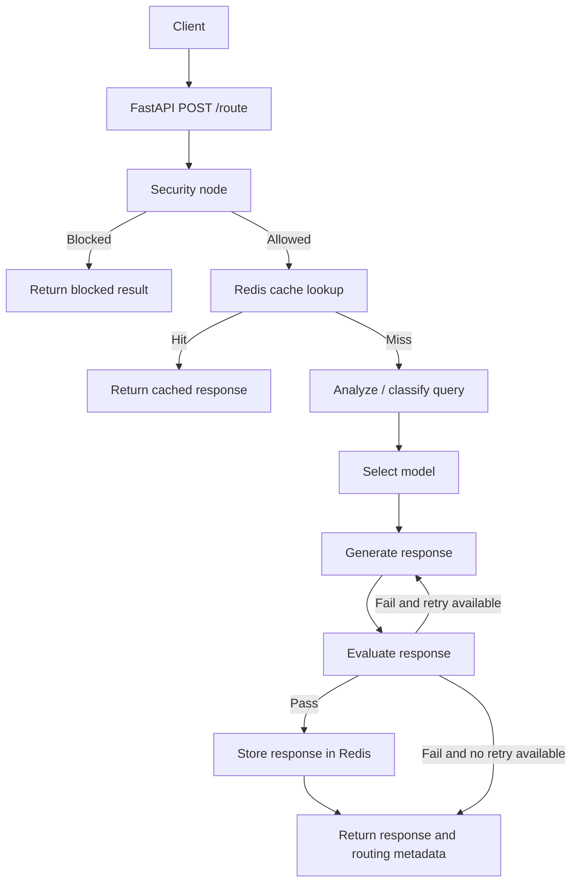

# Agentic LLM Router

A LangGraph-based query router exposed as a FastAPI service. Each incoming query passes through a stateful workflow that screens for suspicious input, checks Redis for a previously approved response, classifies the query, selects an LLM, generates an answer, and evaluates the result before caching it.

The project supports local development and containerized execution with Docker Compose.

## Features

- **Security screening:** Rejects empty queries, queries longer than 1,000 characters, and inputs matching selected prompt-injection or secret-exfiltration patterns.
- **LLM-based routing:** Uses structured output to classify queries by task type and complexity.
- **Model selection:** Routes requests between Groq and Google Gemini according to the classification.
- **Fallback handling:** Falls back to the other configured provider if generation fails.
- **Response evaluation:** Uses heuristic checks and an LLM-as-judge evaluation.
- **Retry handling:** Retries generation at most once when evaluation fails.
- **Redis caching:** Caches responses that pass evaluation for one hour.
- **FastAPI interface:** Exposes the workflow through `POST /route`.
- **Docker Compose:** Runs the FastAPI application and Redis as separate services.

## Tech Stack

| Layer                               | Technology                                            |
| ----------------------------------- | ----------------------------------------------------- |
| API framework                       | FastAPI, Uvicorn                                      |
| Workflow orchestration              | LangGraph (`StateGraph`)                              |
| Data validation / structured output | Pydantic                                              |
| LLM integrations                    | LangChain, `langchain-groq`, `langchain-google-genai` |
| Groq model                          | `openai/gpt-oss-20b`                                  |
| Google model                        | `gemini-3.5-flash-lite`                               |
| Caching                             | Redis (`redis-py`)                                    |
| Configuration                       | `python-dotenv`                                       |
| Containerization                    | Docker, Docker Compose                                |

## System Architecture



## Workflow

The graph is implemented in `app/graph.py` using `StateGraph(RouterState)`.

1. **Security:** Normalizes the query and checks for empty input, excessive length, and configured suspicious patterns.
2. **Cache lookup:** Normalizes the query, creates a SHA-256 cache key, and checks Redis. A cache hit returns the cached answer without calling the LLMs.
3. **Analysis:** Uses Groq structured output to classify the query as `factual`, `reasoning`, `code`, `creative`, or `conversational`, and assigns `low`, `medium`, or `high` complexity.
4. **Model selection:** Uses `MODEL_MAP` to select the model for the task and complexity. If classification fails, the default model is selected.
5. **Generation:** Calls the selected provider. If generation fails, the router attempts the other configured provider.
6. **Evaluation:** Applies heuristic checks for empty, too-short, or degenerate output. If those checks pass, an LLM judge assesses relevance and quality.
7. **Retry and caching:** If evaluation fails, the graph can retry generation once using the fallback model. Responses that pass evaluation are cached in Redis for 3,600 seconds.

## Model Routing

The configured model identifiers are:

| Provider      | Model ID                | Role                                                               |
| ------------- | ----------------------- | ------------------------------------------------------------------ |
| Groq          | `openai/gpt-oss-20b`    | Query classification, selected response generation, and evaluation |
| Google Gemini | `gemini-3.5-flash-lite` | Response generation and fallback                                   |

The exact model selected for a request depends on the `(task_type, complexity)` mapping in `MODEL_MAP`. The default model is Gemini Flash-Lite.

Provider availability, free-tier quotas, and pricing are controlled by the providers and may change. Check the provider dashboards for current limits.

## Redis Caching

Redis is part of the workflow rather than an optional add-on.

- **Cache key:** The query is lower-cased, whitespace-normalized, hashed with SHA-256, and prefixed with `llm_router:`.
- **Read path:** Redis is checked after security screening and before query classification.
- **Write path:** A response is cached only after it passes the evaluation stage.
- **TTL:** Cached responses expire after 3,600 seconds (one hour).
- **Docker networking:** In Docker Compose, the application connects to Redis using the service hostname `redis` and port `6379`.
- **Local development:** When running the API directly on your machine, the default Redis host is `localhost`.

The Redis host and port are configurable through `REDIS_HOST` and `REDIS_PORT`.

## Setup and Running

### Prerequisites

For the recommended Docker Compose setup:

- Docker Desktop (Windows/macOS) or Docker Engine with the Docker Compose plugin (Linux)
- A Groq API key
- A Google Gemini API key

For running the application directly with Python, use Python 3.11 and a locally accessible Redis server.

### 1. Clone the repository

```bash
git clone https://github.com/ianbenedictrego/Agentic-LLM-Router.git
cd Agentic-LLM-Router
```

### 2. Configure environment variables

Create a `.env` file in the project root:

```env
GROQ_API_KEY=your_groq_api_key
GEMINI_API_KEY=your_gemini_api_key
```

Do not commit `.env` or expose API keys in source control. The repository's `.gitignore` should exclude it.

The application reads `GEMINI_API_KEY` and `GROQ_API_KEY`. For Docker Compose, `REDIS_HOST` and `REDIS_PORT` are supplied to the application container by the Compose configuration.

### 3. Start with Docker Compose (recommended)

From the project root, run:

```bash
docker compose up --build
```

This builds the FastAPI image and starts both services:

- **app:** FastAPI application, exposed on host port `8000`.
- **redis:** Redis 7 Alpine container, available to the app at `redis:6379` on the Compose network.

Open the interactive API documentation:

- Swagger UI: <http://localhost:8000/docs>
- OpenAPI schema: <http://localhost:8000/openapi.json>

To check service status:

```bash
docker compose ps
```

To verify Redis is responding:

```bash
docker compose exec redis redis-cli ping
```

Expected output:

```text
PONG
```

To follow application logs:

```bash
docker compose logs -f app
```

To stop the services:

```bash
docker compose down
```

Redis data is stored in the named Docker volume `redis_data` and is preserved when you run `docker compose down`. To remove the volume and its data as well, run:

```bash
docker compose down -v
```

### 4. Run locally without Docker (optional)

If you prefer to run FastAPI directly, create and activate a virtual environment from the repository root.

Windows PowerShell:

```powershell
python -m venv .venv
.venv\Scripts\Activate.ps1
```

macOS/Linux:

```bash
python -m venv .venv
source .venv/bin/activate
```

Install dependencies:

```bash
pip install -r requirements.txt
```

Start a Redis server locally, then run the API from the `app` directory:

```bash
cd app
uvicorn main:app --reload
```

When running locally, the default Redis connection is `localhost:6379`. You can override it by setting `REDIS_HOST` and `REDIS_PORT`.

## API Usage

### `POST /route`

Runs a query through the routing workflow.

Example request:

```bash
curl -X POST http://localhost:8000/route \
  -H "Content-Type: application/json" \
  -d '{"query": "Compare microservices and monolithic architecture"}'
```

Example response shape (values are illustrative):

```json
{
  "query": "Compare microservices and monolithic architecture",
  "safe": true,
  "blocked": false,
  "risk_flag": false,
  "task_type": "reasoning",
  "complexity": "medium",
  "selected_model": "openai/gpt-oss-20b",
  "routing_strategy": "llm-classifier",
  "confidence": 0.92,
  "reason": "The query asks for a comparison.",
  "response": "Generated answer...",
  "evaluation": "pass:good",
  "retry_count": 0,
  "error": ""
}
```

The selected model, classification, confidence, routing strategy, evaluation, retry count, and error details are returned as workflow metadata.

## Security Notes

The security node currently implements a basic pattern-based input filter. It rejects empty queries, queries exceeding 1,000 characters, and queries matching configured patterns related to instruction overrides, prompt disclosure, and API-key disclosure.

This is a first layer of screening, not a comprehensive prompt-injection or application-security solution. Do not treat it as a substitute for authorization, secrets management, provider-side safeguards, or broader security testing.

## Repository Structure

```text
Agentic-LLM-Router/
├── app/
│   ├── main.py             # FastAPI application and POST /route endpoint
│   └── graph.py            # LangGraph workflow, routing, evaluation, and Redis cache
├── Dockerfile              # FastAPI application image
├── docker-compose.yml      # FastAPI and Redis services
├── .dockerignore           # Files excluded from Docker build context
├── .env.example            # Environment variable template (if present)
├── .env                    # Local API keys; do not commit
├── .gitignore
└── requirements.txt        # Python dependencies
```
