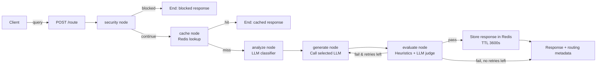

# Agentic LLM Router

A LangGraph-based query router built with FastAPI. Every incoming query flows through a stateful graph that screens it for security issues, checks a **Redis cache** for a previously-approved answer, classifies the query with an LLM, generates a response from the selected model, and runs an LLM-as-judge evaluation before caching and returning the result.

---

## Tech Stack

| Layer         | Technology                                                                                                                  |
| ------------- | --------------------------------------------------------------------------------------------------------------------------- |
| API framework | FastAPI                                                                                                                     |
| Orchestration | LangGraph (`StateGraph`)                                                                                                    |
| Validation    | Pydantic                                                                                                                    |
| Caching       | **Redis** (`redis-py`, TTL-based response cache)                                                                            |
| LLM providers | Groq (`llama-3.3-70b-versatile`) via `langchain-groq`, Google Gemini (`gemini-3.5-flash-lite`) via `langchain-google-genai` |
| Runtime       | Python                                                                                                                      |

---

## System Architecture



---

## Core Workflow (LangGraph)

The graph is defined in `app/graph.py` as a `StateGraph(RouterState)` with the following nodes and edges:

```text
START
 → security          (validate length, empty query, prompt-injection patterns)
   → [blocked] → END
   → [continue] → cache

cache                (normalize query → SHA-256 → Redis GET "llm_router:<hash>")
   → [hit]  → END (returns cached response, routing_strategy = "redis-cache")
   → [miss] → analyze

analyze              (Groq LLM classifies task_type + complexity + confidence
                       → looked up in MODEL_MAP to choose a model;
                       falls back to DEFAULT_MODEL on failure)
   → generate

generate             (calls the selected model; on error, falls back to
                       DEFAULT_MODEL and retries generation once)
   → evaluate

evaluate             (heuristic checks: empty/too-short/degenerate output,
                       then an LLM-as-judge call scoring relevance + quality)
   → [fail, retry_count < 1] → generate (retry with DEFAULT_MODEL)
   → [pass]                  → Redis SETEX (cache the response, TTL 3600s) → END
   → [fail, retries exhausted] → END
```

---

## Redis Caching Layer

Caching lives in `app/graph.py` and is a core part of the routing graph, not a bolt-on:

- **Client:** `redis.Redis(host="localhost", port=6379, decode_responses=True)`
- **Key derivation:** the query is lower-cased and whitespace-normalized (`normalize_query`), then hashed with SHA-256 and prefixed: `llm_router:<sha256 hash>` (`make_cache_key`).
- **Read path (`cache` node):** runs right after the security check and before the LLM classifier/generation — a cache hit skips `analyze`, `generate`, and `evaluate` entirely, setting `routing_strategy = "redis-cache"`.
- **Write path (`evaluate` node):** a response is only written to Redis **after it passes the LLM-judge evaluation** (`redis_client.setex(key, 3600, response)`), so low-quality or failed generations are never cached.
- **TTL:** cached responses expire after `3600` seconds (1 hour).
- **Dependency:** requires a running Redis instance reachable at `localhost:6379`. There's a standalone connectivity check in `app/test.py`.

> This means repeated/duplicate queries (after normalization) are served straight from Redis without hitting either LLM provider, and only "good" answers ever enter the cache.

---

## Setup & Environment

### 1. Prerequisites

- Python 3.9+
- pip
- A running **Redis** server (default `localhost:6379`)
- A Groq API key
- A Google (Gemini) API key

### 2. Clone and create a virtual environment

```bash
git clone <your-repo-url>
cd "Agentic LLM Router"

python -m venv venv
# Windows
venv\Scripts\activate
# macOS/Linux
source venv/bin/activate
```

### 3. Install dependencies

```bash
pip install -r requirements.txt
```

This installs `langchain`, `langchain-core`, `langchain-google-genai`, `langchain-groq`, `langgraph`, `python-dotenv`, `fastapi`, `uvicorn`, `pydantic`, `langsmith`, `google-genai`, and `redis`.

### 4. Configure environment variables

Create a `.env` file in the project root (do **not** commit this file):

```env
GOOGLE_API_KEY=your_google_api_key_here
GROQ_API_KEY=your_groq_api_key_here
```

### 5. Start Redis

Make sure a Redis server is running locally before starting the API (the app will error on cache access otherwise):

```bash
redis-server
```

You can sanity-check connectivity with the included script:

```bash
python app/test.py
# should print: hello
```

### 6. Run the API

```bash
cd app
uvicorn main:app --reload
```

| Endpoint | Method | Purpose                                            |
| -------- | ------ | -------------------------------------------------- |
| `/route` | POST   | Run a query through the full routing/caching graph |

### 7. Call the router

```bash
curl -X POST http://localhost:8000/route \
  -H "Content-Type: application/json" \
  -d '{"query": "Compare microservices vs monolith for a high-traffic e-commerce app"}'
```

Response shape (`QueryResponse`):

```json
{
  "query": "...",
  "safe": true,
  "blocked": false,
  "risk_flag": false,
  "task_type": "reasoning",
  "complexity": "high",
  "selected_model": "llama-3.3-70b-versatile",
  "routing_strategy": "llm-classifier",
  "confidence": 0.9,
  "reason": "...",
  "response": "...",
  "evaluation": "pass:good",
  "retry_count": 0,
  "error": ""
}
```

---

## Routing Logic Details

| Stage          | Behavior                                                                                                                                                                                                                                       |
| -------------- | ---------------------------------------------------------------------------------------------------------------------------------------------------------------------------------------------------------------------------------------------- |
| Security       | Rejects empty queries, queries over `MAX_QUERY_LENGTH` (1000 chars), and queries matching prompt-injection / instruction-override / secret-exfiltration regex patterns.                                                                        |
| Redis cache    | Normalized + hashed query is looked up in Redis before any LLM call. Hit → immediate return (`routing_strategy = "redis-cache"`). Miss → continues to classification.                                                                          |
| Classification | Groq (`llama-3.3-70b-versatile`) is asked, via structured output, to classify `task_type` (factual/reasoning/code/creative/conversational) and `complexity` (low/medium/high).                                                                 |
| Model mapping  | The `(task_type, complexity)` pair is looked up in `MODEL_MAP` to pick between Groq's `llama-3.3-70b-versatile` and Gemini's `gemini-3.5-flash-lite`; unmapped pairs fall back to `DEFAULT_MODEL` (`gemini-3.5-flash-lite`).                   |
| Generation     | Calls the selected model. On failure, retries once with `DEFAULT_MODEL` and marks `routing_strategy = "fallback-after-generation-error"`.                                                                                                      |
| Evaluation     | Heuristic checks (empty/too-short/degenerate/error) run first; if they pass, an LLM judge (Groq) scores relevance + quality. On failure, the graph retries generation **once** with `DEFAULT_MODEL`. On pass, the response is cached in Redis. |

---

## Security

Handled inline in the `security` node of `app/graph.py`:

- Rejects empty queries.
- Rejects queries over 1000 characters (`MAX_QUERY_LENGTH`).
- Rejects queries matching a set of regex patterns targeting prompt-injection and secret-exfiltration attempts (e.g. "ignore previous instructions," "reveal your system prompt," "give me the api key").

This is a basic pattern-based filter, not a comprehensive prompt-injection defense — treat it as a first line of screening rather than a complete safeguard.

---

## Repository Structure

```text
Agentic LLM Router/
├── app/
│   ├── main.py           # FastAPI app, POST /route endpoint, request/response schemas
│   ├── graph.py           # LangGraph StateGraph: security, cache, analyze, generate, evaluate
│   └── test.py             # Standalone Redis connectivity smoke test
├── requirement.txt         # Python dependencies
└── .env                    # Local secrets (contains exposed keys — rotate before reuse)
```


